# Human Writing Skills

Three Claude skills that revise AI-assisted drafts using findings from published research on how AI writing differs from human writing. Each rule in the skills traces back to a measured result in one of five papers, and each skill makes the model show its evidence before it changes anything.

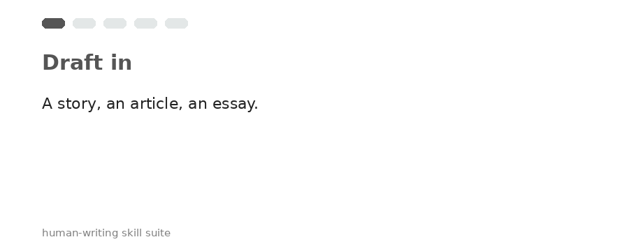

| Skill | Use it for | Built from |
|---|---|---|
| [`human-narrative-craft`](skills/human-narrative-craft/SKILL.md) | Short fiction: plot, theme, time, endings, characters | StoryScope (COLM 2026) |
| [`human-nonfiction-voice`](skills/human-nonfiction-voice/SKILL.md) | Articles, essays, blog posts: angle, quotes, openings, endings | Russell, Karpinska & Iyyer (ACL 2025) |
| [`ai-prose-line-edit`](skills/ai-prose-line-edit/SKILL.md) | Any genre: sentences, grammar, word choice | LAMP · Reinhart et al. · Rallapalli et al. |

> **Not affiliated with any of the authors below.** This repo turns their published findings into editing instructions. All credit for the research belongs to them. Please cite the papers, not this repo.

---

## Contents

1. [Credits](#credits)
2. [How the skills fit together](#how-the-skills-fit-together)
3. [The research, paper by paper](#the-research-paper-by-paper)
4. [How the research became the skills](#how-the-research-became-the-skills)
5. [Design: why three skills instead of one](#design-why-three-skills-instead-of-one)
6. [Installation](#installation)
7. [Usage](#usage)
8. [Limitations](#limitations)
9. [Responsible use](#responsible-use)

---

## Credits

| Paper | Authors | Venue | Link |
|---|---|---|---|
| **StoryScope: Investigating Idiosyncrasies in AI Fiction** | Jenna Russell, Rishanth Rajendhran, Chau Minh Pham, Mohit Iyyer (University of Maryland); John Wieting (Google DeepMind) | COLM 2026 | [arXiv:2604.03136](https://arxiv.org/abs/2604.03136) · [code & data](https://github.com/jenna-russell/storyscope) |
| **People who frequently use ChatGPT for writing tasks are accurate and robust detectors of AI-generated text** | Jenna Russell, Marzena Karpinska, Mohit Iyyer | ACL 2025 (Long Papers, pp. 5342–5373) | [ACL Anthology](https://aclanthology.org/2025.acl-long.267.pdf) · [arXiv:2501.15654](https://arxiv.org/abs/2501.15654) |
| **Can AI writing be salvaged? Mitigating Idiosyncrasies and Improving Human-AI Alignment in the Writing Process through Edits** (LAMP) | Tuhin Chakrabarty, Philippe Laban, Chien-Sheng Wu | arXiv preprint | [arXiv:2409.14509](https://arxiv.org/abs/2409.14509) |
| **Do LLMs write like humans? Variation in grammatical and rhetorical styles** | Alex Reinhart, Ben Markey, Michael Laudenbach, Kachatad Pantusen, Ronald Yurko, Gordon Weinberg, David West Brown (Carnegie Mellon University, NJIT) | arXiv preprint (PNAS-formatted) | [arXiv:2410.16107](https://arxiv.org/abs/2410.16107) |
| **Interpretable Stylistic Variation in Human and LLM Writing Across Genres, Models, and Decoding Strategies** | Swati Rallapalli, Shannon Gallagher, Ronald Yurko, Tyler Brooks, Chuck Loughin, Michele Sezgin, Violet Turri (Carnegie Mellon University) | arXiv preprint | [arXiv:2604.14111](https://arxiv.org/abs/2604.14111) |

<details>
<summary><b>BibTeX</b></summary>

```bibtex
@misc{russell2026storyscope,
  title         = {StoryScope: Investigating Idiosyncrasies in AI Fiction},
  author        = {Russell, Jenna and Rajendhran, Rishanth and Pham, Chau Minh and Iyyer, Mohit and Wieting, John},
  year          = {2026},
  note          = {COLM 2026},
  eprint        = {2604.03136},
  archivePrefix = {arXiv}
}

@inproceedings{russell2025people,
  title     = {People who frequently use ChatGPT for writing tasks are accurate and robust detectors of AI-generated text},
  author    = {Russell, Jenna and Karpinska, Marzena and Iyyer, Mohit},
  booktitle = {Proceedings of the 63rd Annual Meeting of the Association for Computational Linguistics (Volume 1: Long Papers)},
  pages     = {5342--5373},
  year      = {2025}
}

@misc{chakrabarty2024salvaged,
  title         = {Can AI writing be salvaged? Mitigating Idiosyncrasies and Improving Human-AI Alignment in the Writing Process through Edits},
  author        = {Chakrabarty, Tuhin and Laban, Philippe and Wu, Chien-Sheng},
  year          = {2024},
  eprint        = {2409.14509},
  archivePrefix = {arXiv}
}

@misc{reinhart2024llms,
  title         = {Do LLMs write like humans? Variation in grammatical and rhetorical styles},
  author        = {Reinhart, Alex and Markey, Ben and Laudenbach, Michael and Pantusen, Kachatad and Yurko, Ronald and Weinberg, Gordon and Brown, David West},
  year          = {2024},
  eprint        = {2410.16107},
  archivePrefix = {arXiv}
}

@misc{rallapalli2026stylistic,
  title         = {Interpretable Stylistic Variation in Human and LLM Writing Across Genres, Models, and Decoding Strategies},
  author        = {Rallapalli, Swati and Gallagher, Shannon and Yurko, Ronald and Brooks, Tyler and Loughin, Chuck and Sezgin, Michele and Turri, Violet},
  year          = {2026},
  eprint        = {2604.14111},
  archivePrefix = {arXiv}
}
```
</details>

---

## How the skills fit together

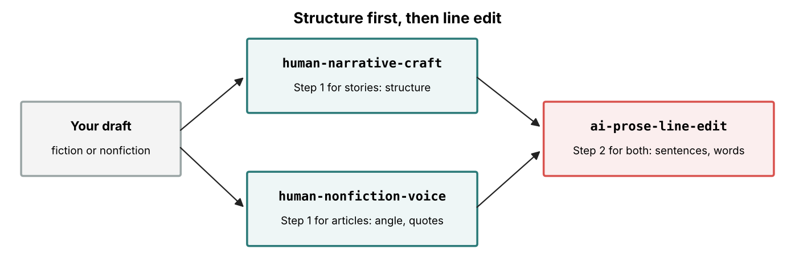

Fix structure first, then fix sentences. StoryScope found that cleaning up AI stories at the sentence level barely changed detection: macro-F1 went from 95.5% to 93.9% after LAMP-style edits. Polishing sentences cannot repair a story whose structure is AI-typical, so the structural skill runs first and the line edit runs second.

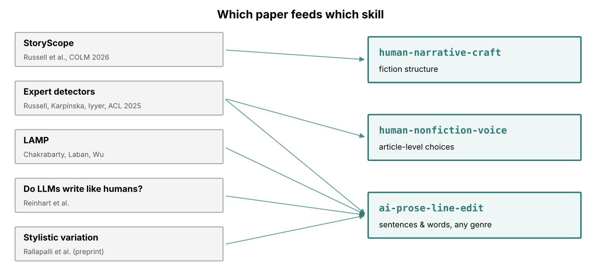

---

## The research, paper by paper

### 1. StoryScope (Russell et al., COLM 2026): story structure

**Question.** Can AI fiction be told apart from human fiction using narrative choices alone, with no help from word choice or style?

**Data.** The authors took 10,272 human short stories from Books3, averaging about 6,400 words, and wrote a prompt for each one with Gemini 2.5 Flash. Five models then wrote a story from every prompt: Claude Sonnet 4.6, GPT-5.4, Gemini 3 Flash, DeepSeek V3.2 and Kimi K2.5. That gives 61,608 stories in total.

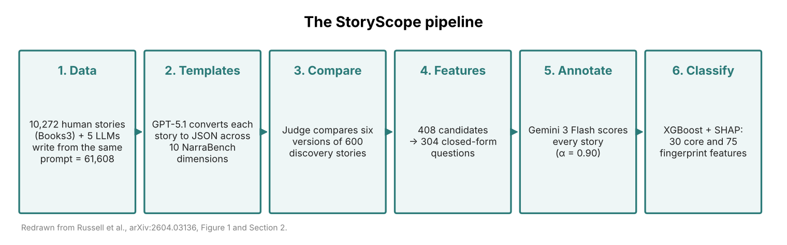

**Method.**
- GPT-5.1 converted each story into a structured outline covering 10 narrative dimensions from NarraBench.
- A 600-story discovery pool was compared across sources, producing 408 candidate features. After removing duplicates, 304 remained.
- Gemini 3 Flash scored every story on every feature. Agreement across repeated runs was α = 0.90, and agreement with human annotators was κ = 0.84, against κ = 0.74 between two humans.
- An XGBoost classifier with SHAP explanations identified **30 core features** that separate human from AI writing, plus **75 fingerprint features** specific to individual models.

**Results.**

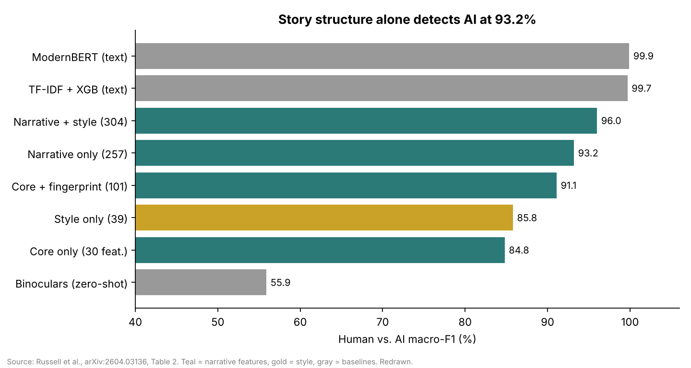

- Narrative features alone reach **93.2% macro-F1** at telling human from AI. That is 97% of what narrative and style features achieve together.
- Telling all six sources apart (human plus five models) reaches **68.4%**. Chance is 16.7%.
- The results hold after length-matching (93.2%), across topics (Kruskal–Wallis p = 0.46), and after removing stories the models may have memorized.

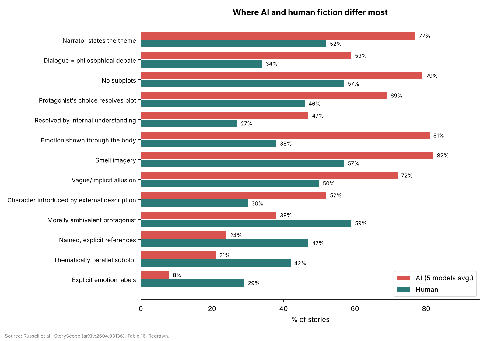

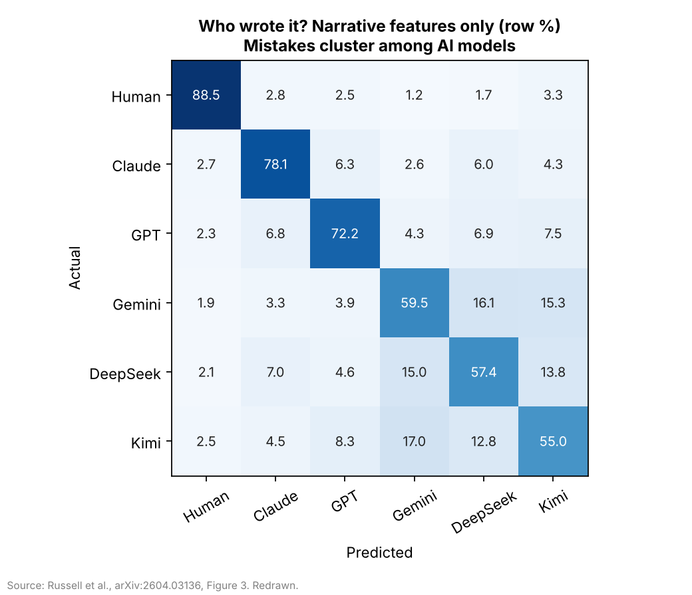

The models cluster together. The distance between the human and AI centroids is 1.6× the distance between AI models. Human stories are rarer: their mean rarity percentile is 0.71 against 0.49 for AI, and the human version was the most unusual of the six in 57.8% of prompts.

### 2. Russell, Karpinska & Iyyer (ACL 2025): what expert readers notice

**Question.** Can people tell AI-written articles from human ones, and what gives the AI ones away?

**Data.** The authors used 300 American nonfiction articles under 1,000 words from AP, the New York Times, the Wall Street Journal, National Geographic, Smithsonian and other outlets. Each was paired with an AI version written from the same title by GPT-4o, Claude 3.5 Sonnet or o1-Pro. Some AI versions were paraphrased or "humanized."

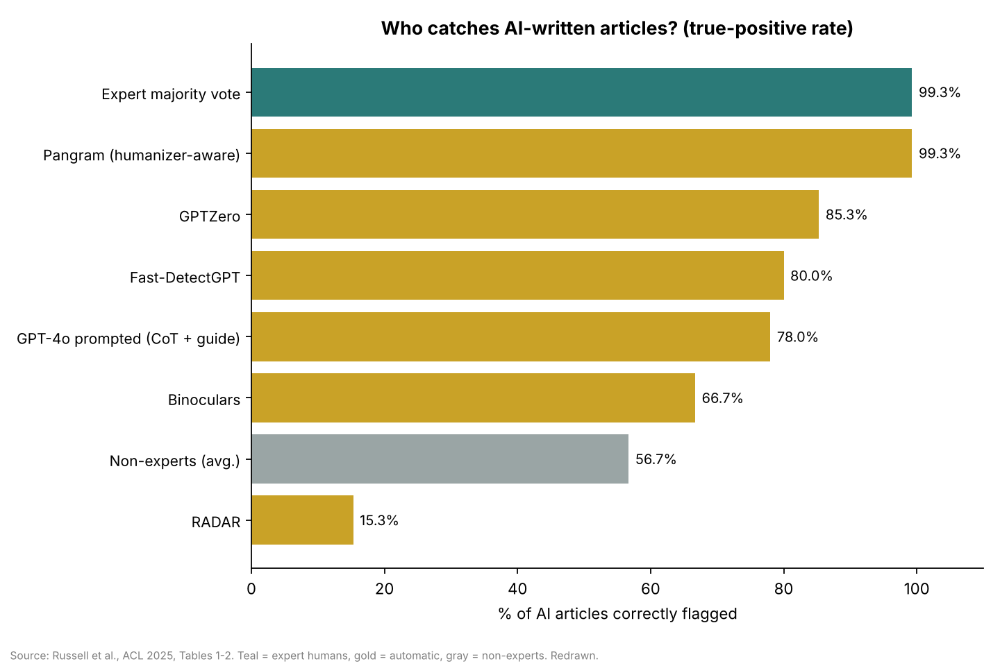

- Five annotators who use ChatGPT heavily, voting by majority, misclassified **1 article out of 300**. They caught every humanized o1-Pro article.
- Non-experts performed near chance, flagging about 57% of AI articles and about 52% of human ones.
- The commercial detector Pangram matched the experts. Open-source detectors such as Binoculars and RADAR fell far behind.

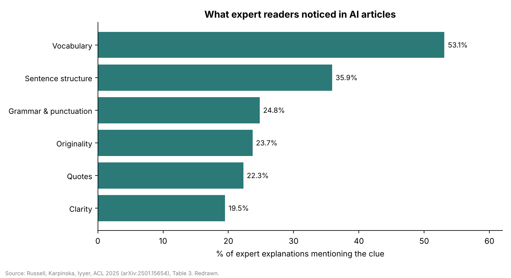

Clues the experts cited:
- **Placeholder names.** Emily or Sarah appeared in 63% of GPT-4o articles and 70% of Claude articles.
- **Attribution verbs.** AI writes "notes" and "explains" where humans repeat "says".
- **Quotes.** AI quotes are formal and placed at the ends of paragraphs.
- **Openings and endings.** AI opens by setting a scene and closes on a tidy, upbeat summary.
- **Formatting.** AI uses bolded list headers.
- **Content.** AI avoids controversy and mild profanity.

Experts who relied on vocabulary alone made the most mistakes.

### 3. LAMP (Chakrabarty, Laban & Wu): what professional writers fix

**Data.** Professional writers made **8,035 edits** to 1,057 paragraphs written by GPT-4o, Claude 3.5 Sonnet and Llama 3.1 70B. The paragraphs covered fiction (from The New Yorker), travel, food, personal essays and advice.

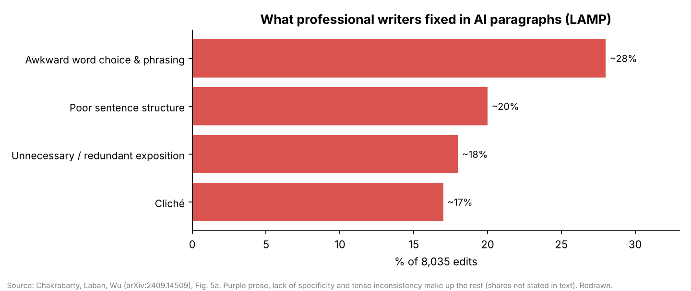

The writers' edits fell into seven categories: awkward word choice (~28%), poor sentence structure (~20%), redundant exposition (~18%), cliché (~17%), purple prose, lack of specificity, and tense inconsistency. Writers almost never needed an "other" category (10 of 8,035 edits).

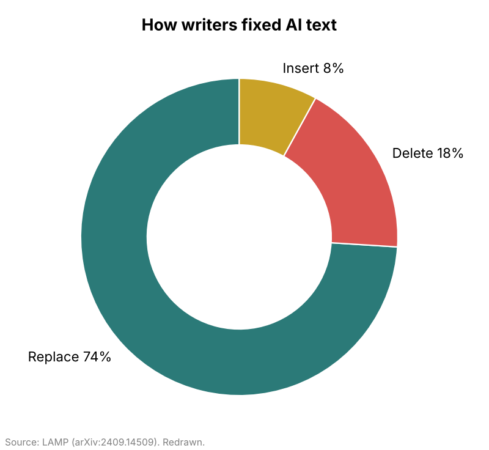

- Most edits replaced or deleted text rather than adding to it.
- Lower-quality paragraphs needed more edits: 10.2 for a paragraph rated 2, against 2.4 for one rated 10.
- 15 of the 50 most common part-of-speech templates in LLM text rarely appear in human text, for example "a [noun] of [noun] and [noun]."

### 4. Reinhart et al.: grammar and vocabulary

**Data.** The authors split human texts in half and asked six models (GPT-4o, GPT-4o mini, and four Llama 3 variants) to continue each one "in the same style, tone, and diction." They then compared 66 grammatical features against the human continuation. The texts came from two corpora, HAP-E (8,290 texts) and CAP (9,615 texts), covering academic writing, news, fiction, speech, blogs and scripts.

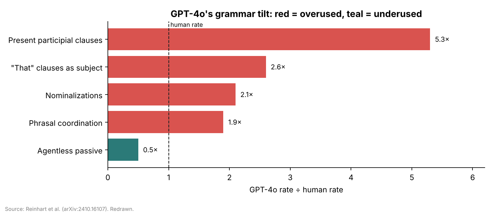

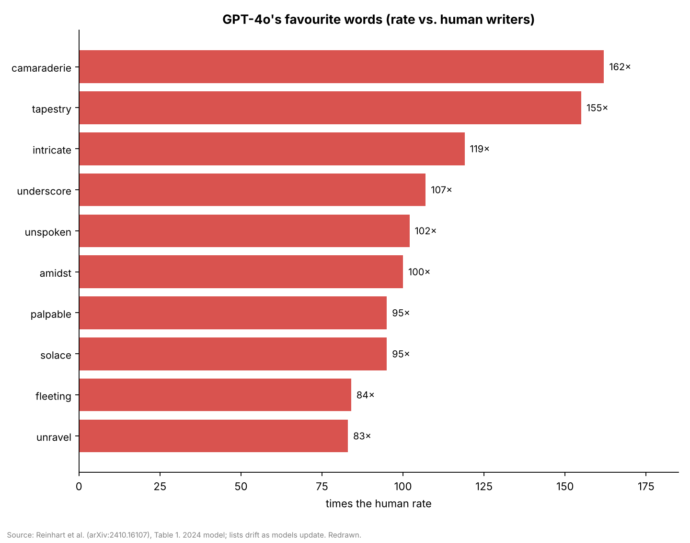

- Instruction-tuned models drifted further from human style than base models. Larger models (70B) were no more human-like than smaller ones (8B).
- A classifier could pick the source of a text among seven (human plus six models) with 66% accuracy, against 14% by chance. Only 4.2% of LLM texts were mistaken for human.
- "Tapestry" appeared in 23% of GPT-4o texts, and "amidst" in 27%.

### 5. Rallapalli et al. (preprint): genres, models, decoding

**Data.** The study covers 11 models, 8 genres and 4 decoding strategies, taken from the RAID dataset (467,985 texts), using 67 Biber features.

- **Overused by LLMs:** "that" clauses as subjects, contractions, past-participle clauses after nouns ("the data collected by"), nominalizations, and "which" clauses that comment on a whole sentence.
- **Underused by LLMs:** wh-object clauses ("what you did"), pied-piping ("in which"), concessive "though", negation built from "no" or "neither" rather than "not", and discourse particles ("well", "anyway"). Humans already use these rarely, at about 0.2–1.2 per 1,000 words, and LLMs suppress them further.
- **Genre and model matter most.** Genre shapes style more than whether a human or a model wrote the text. The choice of model matters more than the decoding strategy. Chat-tuned models cluster together.

---

## How the research became the skills

| Finding | Paper | Where it lives | Why |
|---|---|---|---|
| Narrative features alone reach 93.2%, and style edits barely move detection | StoryScope | `human-narrative-craft` core principle; the routing order | Structure is the hard part to change, so it is fixed first. |
| No single narrative dimension is enough; characters alone reach 80.2% | StoryScope (ablations) | "Revise characters, plot, time, and references together, starting with characters" | Fixing one habit does not change the overall profile. |
| 30 core features with human and AI rates | StoryScope (Table 16) | The diagnostic table and the human-leaning list | Each rule carries its numbers so the model knows how strong the tendency is. |
| Per-model fingerprints | StoryScope (Table 17) | The self-check section | Models check their own known habits first. |
| Narrative templates before comparison | StoryScope (§2, Fig. 8) | The Outline step | Judge the structure, not the prose. |
| Expert clue taxonomy | Russell 2025 | The `human-nonfiction-voice` audit table | One audit row per clue the experts used. |
| Human nonfiction is full of verifiable specifics | Russell 2025 | The hard rule against invented quotes or sources, with [NEEDS SOURCE] placeholders | Without this, a model trying to sound human may fabricate details. |
| Pangram still caught 99.3% of humanized text | Russell 2025 | Responsible-use rule | The skills aim at better writing, not at evading detectors. |
| Seven edit categories and their frequencies | LAMP | `ai-prose-line-edit` Pass 1, ordered by frequency | Fix the most common problems first. |
| Edits were 74% replacements and 18% deletions | LAMP | The principle "swap or cut, rarely add" | Matches what professional writers actually did. |
| Grammar ratios (5.3×, 2.6×, 2.1×, 1.9×, 0.5×) | Reinhart | Pass 2 counts per paragraph | Swapping words cannot fix a grammatical tilt. |
| Overused word lists | Reinhart; Russell | Pass 3 flags (not bans) | Experts who over-relied on vocabulary made more false positives. |
| LLMs overuse contractions | Rallapalli | "Don't add contractions as noise" | Contractions are not a reliable human signal. |
| Rare constructions are suppressed | Rallapalli | The underused list in Pass 2 | Gives the model human options to reach for. |

**Where the papers disagree.** Russell's annotators treated contractions as a human signal, but Rallapalli found LLMs overuse them, so the skills do not add contractions. Reinhart found GPT-4o overuses downtoners ("barely", "nearly"), while Rallapalli found all models underuse them, so the skills leave downtoners out.

**Correction to the earlier draft.** In StoryScope, the figures for fourth-wall breaks and direct reader address (0.67 vs 0.39, and 0.28 vs 0.07) are average scores on an ordinal scale, not percentages.

**Not used.** O'Sullivan (2025) in *Humanities and Social Sciences Communications* is peer-reviewed. It reports clustering plots but no numbers that could be turned into editing rules.

---

## Design: why three skills instead of one

A single skill holding all five papers would run to about 3,000 words. Models tend to skim the middle of long instructions and compress checklists, so the material is split:

- **Each skill stays short.** Each is under about 1,100 words and covers one level of writing.
- **The audits force full coverage.** Each one requires a table with **one row per check**, containing a quoted line or the word "absent", and forbids skipping or merging rows. A skipped check therefore shows up as a missing row.
- **Each rule is concrete.** It has a number and an example, not a vague instruction like "add variety".
- **The skills point to each other.** Each says which skill comes next, so the steps run in the right order.

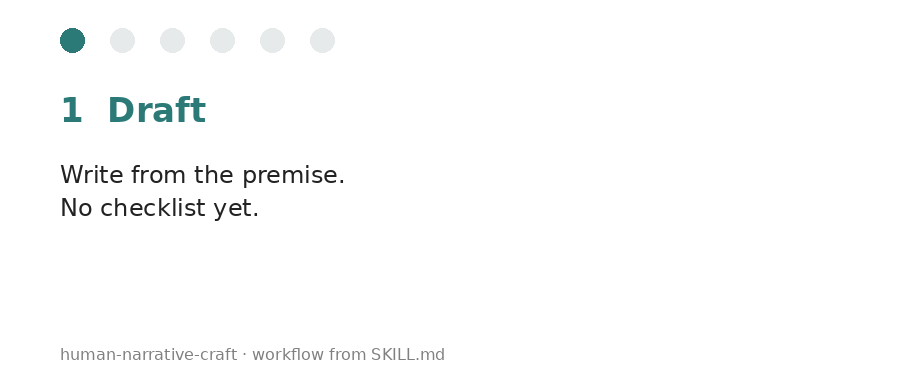

---

## Installation

**Claude Code**

```bash
git clone https://github.com/<you>/human-writing-skills.git
cp -r human-writing-skills/skills/* ~/.claude/skills/
```

**Claude.ai:** zip each folder in `skills/` and upload it under Settings → Capabilities → Skills.

---

## Usage

```text
Revise this short story so it doesn't fall into AI narrative defaults. Show the audit table first.
```

```text
Turn these interview notes into an 800-word article. Use only the quotes I gave you, then line-edit it.
```

```text
Line-edit this cover letter for AI-sounding phrasing. Keep my voice and list every change.
```

---

## Limitations

- **The skills are untested.** They have not yet been evaluated with and without the skill on real drafts.
- **Word lists date quickly.** They come from 2024–2025 models (GPT-4o, Llama 3) and will drift as models are updated.
- **Each paper has a narrow scope:**
  - StoryScope: stories of about 5,000 words.
  - Russell: articles under 1,000 words.
  - LAMP: mostly literary fiction (about 80%).
- **Three of the five sources are preprints.** Rallapalli's ratios appear only in its charts.
- **The skills cover writing only.** They do not address factual accuracy.
- **All charts here are redrawn from the papers' published numbers.** The original figures belong to their authors.

## Responsible use

These skills are for improving writing, not for hiding authorship. Do not use them to present AI-generated work as fully human-written where disclosure is expected, such as coursework, contests, journalism, or publishers and platforms with AI-use policies. The nonfiction skill forbids invented quotes, people, statistics and sources. Even so, the research shows that trained readers and modern detectors still catch most AI text.
